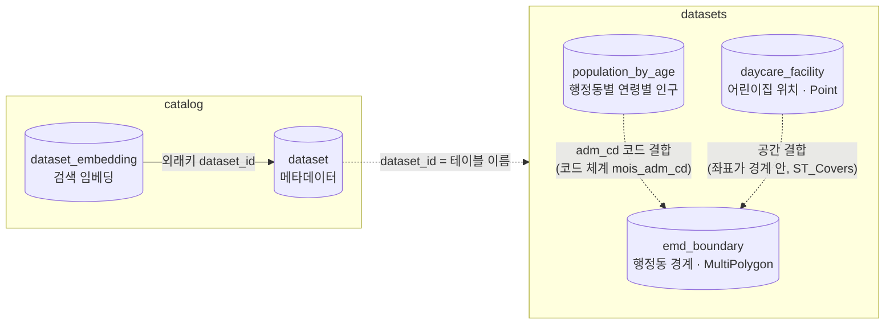

# 데이터 수집·적재 현황과 향후 방향 — 데이터 담당자 전달 문서

- 작성일: 2026-10-09
- 기준 코드: `main` 브랜치 `0958c83`
- 대상: 데이터 수집·처리 방식을 결정할 데이터 담당자

이 문서는 세 가지를 담는다.

1. 지금 데이터가 어떻게 저장·적재·활용되는지 (사실)
2. 여러 공공데이터를 범용으로 수집하기 위해 개발 쪽에서 조사한 내용과 의견 (제안)
3. 데이터 담당자가 결정해 줄 사항 (결정)

권장안은 개발 쪽 의견이며 결정은 담당자가 한다. 분석 엔진이 데이터에 요구하는 계약(6장)만 지키면 수집·처리 방식은 자유롭게 정할 수 있다.

## 요약

- **현재:** 서울특별시 3개 Dataset(행정동 경계, 행정동별 연령별 인구, 어린이집 위치)을 PostgreSQL 17 + PostGIS + pgvector에 적재해 쓴다. Dataset마다 전용 코드(어댑터, 적재 함수, 테이블, 메타데이터)를 만들어 수동으로 등록한다.
- **메타데이터가 계약이다:** 분석 엔진(LLM Agent + GIS 실행)은 테이블 내용보다 카탈로그 메타데이터에 의존한다. 컬럼의 의미 유형, 조인 키의 코드 체계, 공간·시간 정보가 틀리면 분석이 실패하거나 조용히 틀린다.
- **한계:** Dataset이 늘수록 개발 작업이 비례해 늘고, 원본 컬럼 대부분을 버리며(어린이집 62개 중 6개 적재), 이력과 자동 갱신이 없다.
- **권장 방향:** 계열별 정규 스키마(시설, 지역 통계, 경계) + 표준 계열 출처 우선 + 등록할 때 한 번 만드는 선언형 컬럼 매핑(값 검사, 동의어 사전, LLM 초안, 사람 승인) + 원본 보존 + 공간 결합 기반 위치 정규화.
- **결정 요청:** 7장. 먼저 정할 것은 수집 범위, 정규 스키마 채택, 부가 컬럼 보존, 매핑·승인 절차다.

## 목차

1. [용어](#1-용어)
2. [현재 DB 구조](#2-현재-db-구조)
3. [현재 수집·적재 방식](#3-현재-수집적재-방식)
4. [데이터가 분석에 쓰이는 방식](#4-데이터가-분석에-쓰이는-방식)
5. [향후 수집·처리 방향](#5-향후-수집처리-방향-조사-결과와-개발-쪽-의견)
6. [분석 엔진이 데이터에 요구하는 계약](#6-분석-엔진이-데이터에-요구하는-계약)
7. [데이터 담당자 결정 사항](#7-데이터-담당자-결정-사항)
8. [참고](#8-참고)

## 1. 용어

| 용어 | 뜻 |
|---|---|
| Dataset | 분석에 쓰는 데이터 한 묶음. `dataset_id`로 식별하고 테이블 하나에 대응한다 (예: `daycare_facility`) |
| 카탈로그 | Dataset 메타데이터 목록(`catalog.dataset`). Agent는 이것을 보고 데이터를 고르고 분석을 계획한다 |
| 의미 유형 (`semantic_type`) | 컬럼이 무엇을 뜻하는지 나타내는 정해진 값 (예: `administrative_code`, `latitude`). 분석 코드는 컬럼을 이름이 아니라 의미 유형으로 찾는다 |
| 조인 키, 코드 체계 | Dataset끼리 결합할 때 쓰는 컬럼과 그 코드 체계 (예: 행안부 10자리 행정기관코드 `mois_adm_cd`). 코드 체계가 다르면 결합을 막는다 |
| 품질 기록 (`quality_notes`) | 적재할 때 제외·보정한 내용. 분석 결과의 "한계"에 그대로 표시된다 |
| 어댑터 | 출처별 원본 형식을 읽어 내부 형식으로 바꾸는 코드 |
| Provenance | 분석 1회의 실행 기록 (질문, 사용한 Dataset과 기준 시점, 계획, 실행 연산, 결과) |
| 계열 (정규 스키마) | 5장에서 제안하는 개념. 같은 모양의 Dataset이 따르는 공통 테이블 구조 (시설, 지역 통계, 경계) |
| 선언 파일 (매니페스트) | 5장에서 제안하는 개념. Dataset의 출처, 컬럼 매핑, 품질 규칙, 메타데이터를 코드 대신 적는 파일 |

## 2. 현재 DB 구조

### 2.1 환경

| 항목 | 내용 |
|---|---|
| DBMS | PostgreSQL 17.6, PostGIS 3.5.3, pgvector 0.8.7 |
| 실행 | Docker. [docker/postgres/Dockerfile](../docker/postgres/Dockerfile)(PostGIS 이미지 `imresamu/postgis:17-3.5`에 pgvector 추가), [docker-compose.yml](../docker-compose.yml)의 `db` 서비스, 포트 5432, 볼륨 `pgdata` |
| 스키마 정의 | [app/db/schema.sql](../app/db/schema.sql). `python -m app.cli init-db`로 적용하며, `CREATE ... IF NOT EXISTS`라 반복 실행해도 안전하다 |
| 크기 | 약 27MB (2026-10-09) |
| 테스트 DB | `mapgpt_test`. 테스트 세션마다 스키마를 새로 만든다 |

마이그레이션 도구는 없다. `IF NOT EXISTS` 방식이라 이미 있는 테이블의 컬럼 변경은 반영되지 않는다. 구조를 바꾸면 테이블을 직접 지우고 다시 만들어야 한다. 검색 임베딩 테이블 구조를 바꿀 때 실제로 그렇게 했다.

### 2.2 스키마와 테이블

```text
catalog   ── dataset              Dataset 메타데이터 (JSONB)
          └─ dataset_embedding    Dataset 검색용 임베딩 (pgvector)
datasets  ── emd_boundary         행정동 경계 (MultiPolygon)
          ├─ population_by_age    행정동별 1세 단위 인구 (세로형)
          └─ daycare_facility     어린이집 위치 (Point)
analysis  ── run                  분석 실행 기록 (Provenance)
          └─ result               분석 결과 (GeoJSON 포함)
```

| 테이블 | 주요 컬럼 | 키·인덱스 | 행 수 |
|---|---|---|---|
| `catalog.dataset` | `dataset_id`, `metadata`(JSONB, 2.3절), `loaded_at` | PK `dataset_id` | 3 |
| `catalog.dataset_embedding` | `dataset_id`, `model`, `source_text`(임베딩한 문서), `embedding` vector(1536), `embedded_at` | PK·FK `dataset_id`, HNSW(코사인) | 3 |
| `datasets.emd_boundary` | `adm_cd`, `adm_nm`, `sido_cd`, `sido_nm`, `sigungu_cd`, `sigungu_nm`, `geom` MultiPolygon(4326) | PK `adm_cd`, GiST `geom` | 427 |
| `datasets.population_by_age` | `adm_cd`, `age`, `population`, `reference_date` | PK (`adm_cd`, `age`) | 47,397 (427개 동 × 0~110세) |
| `datasets.daycare_facility` | `facility_id`, `name`, `facility_type`, `latitude`, `longitude`, `geom` Point(4326) | PK `facility_id`, GiST `geom` | 3,895 |
| `analysis.run` | `run_id`, `question`, `status`, `analysis_plan`, `datasets`(ID·기준 시점), `operations`, `crs`, `result_id`, `llm_provider`, `llm_model`, `errors`, `state`(Agent 상태 전체), 시작·종료 시각 | PK `run_id` | 15 |
| `analysis.result` | `result_id`, `run_id`, `response`(최종 응답 JSONB), `created_at` | PK `result_id`, FK `run_id` | 10 |

Dataset 테이블의 이름은 `datasets.<dataset_id>`로 정해져 있다. 분석 코드가 이 규칙으로 테이블을 찾는다.

테이블 사이 관계는 다음과 같다 (실선은 외래키, 점선은 분석할 때 맺는 결합, 실행 기록인 `analysis`는 생략).



Dataset 테이블끼리는 외래키가 없다. 표 데이터는 경계와 같은 코드 체계의 조인 키로, 점 데이터는 좌표가 경계 안에 있는지로 분석할 때 결합한다. 결합할 수 있는지는 메타데이터(조인 키의 코드 체계, 좌표계)로 판단하므로, 저장 구조를 바꾸더라도 6장의 계약을 지키면 결합은 유지된다.

### 2.3 카탈로그 메타데이터 (`catalog.dataset.metadata`)

메타데이터는 Pydantic 모델 `DatasetMetadata`([app/domain/catalog.py](../app/domain/catalog.py))를 JSON으로 저장한 것이다. 대부분의 값은 [app/catalog/definitions.py](../app/catalog/definitions.py)에 코드로 적혀 있고(정적 정의), 일부는 적재할 때 계산한다.

| 필드 | 뜻 | 채우는 곳 |
|---|---|---|
| `dataset_id`, `title`, `description`, `category`, `semantic_tags` | 식별자, 제목, 설명, 분류, 검색 태그 | 정적 정의 |
| `provider`, `source`, `license` | 제공기관, 출처, 라이선스 | 정적 정의 |
| `spatial.level` | 공간 단위(`sido`, `sigungu`, `emd`). 점 데이터는 비어 있다 | 정적 정의 |
| `spatial.geometry_type`, `spatial.crs` | Point, Polygon, MultiPolygon 구분과 좌표계 (예: EPSG:4326) | 정적 정의 |
| `spatial.coverage` | 대상 지역 (현재 모두 서울특별시, 코드 11) | 정적 정의 |
| `spatial.bbox`, `spatial.feature_count` | 범위, 공간 객체 수 | 적재 시 계산 |
| `temporal.reference_date` | 기준 시점 | 적재 시 결정 |
| `temporal.update_cycle` | 갱신 주기 | 정적 정의 |
| `columns[]` | 컬럼별 이름, 설명, 데이터 타입, 의미 유형, 단위, null 허용 | 정적 정의 |
| `join_keys[]` | 조인 키 컬럼, 의미 유형, 코드 체계 | 정적 정의 |
| `quality_notes[]` | 적재 시 제외·보정 기록 | 적재 시 기록 |

- **의미 유형 (15개):** `administrative_code`, `administrative_name`, `sido_code`, `sido_name`, `sigungu_code`, `sigungu_name`, `age`, `population`, `facility_id`, `facility_name`, `facility_type`, `latitude`, `longitude`, `reference_date`, `geometry`
- **코드 체계:** 현재 `mois_adm_cd`(행안부 10자리 행정기관코드) 하나다.

현재 카탈로그 값은 다음과 같다.

| Dataset | 기준 시점 | 객체 수 | 품질 기록 |
|---|---|---|---|
| `emd_boundary` | 2026-07-01 | 427 | 없음 |
| `population_by_age` | 2026-09-30 | (표 데이터) | 없음 |
| `daycare_facility` | 2026-10-07 | 3,895 | 아래 4건 |

어린이집 품질 기록은 다음과 같다.
- 운영 중이 아닌 시설 5,575건 제외 (폐지 5,504, 휴지 68, 미기재 3)
- 기본값 좌표 1곳의 시설 18건 제외
- 신고한 자치구가 아닌 다른 자치구에 좌표가 있는 시설 6건 제외
- 서울 경계 밖 1건 제외

## 3. 현재 수집·적재 방식

### 3.1 출처

| Dataset | 출처 | 수집 방식 | 원본 파일 (`data/raw/`) | 기준 시점 결정 | 라이선스 |
|---|---|---|---|---|---|
| 행정동 경계 | GitHub vuski/admdongkor `ver20260701` (통계청 SGIS 가공) | `download` 명령, 고정 URL | `HangJeongDong_ver20260701.geojson` | 파일명의 `verYYYYMMDD` | CC BY 4.0 |
| 연령별 인구 | 공공데이터포털 15097972 파일데이터 (행정안전부) | `download` 명령, 고정 다운로드 링크 | `mois_population_by_age_20260930.csv` (cp949, 연령이 열로 펼쳐진 wide 형식) | CSV의 `기준연월` 컬럼 | 이용허락범위 제한 없음 |
| 어린이집 | 서울 열린데이터광장 OpenAPI `ChildCareInfo` (OA-20300) | 캐시가 없거나 `--refresh`일 때 API 호출 (1,000건씩 페이지) | `seoul_childcare_YYYYMMDD.json` (수집일별 캐시, 원본 62개 컬럼) | 행별 `DATASTDRDT`의 최댓값 | 공공누리 제4유형 (출처표시, 상업적 이용금지, 변경금지) |

- `data/`는 용량과 라이선스 때문에 git에서 제외되어 있다.
- 인증키는 `.env`에 둔다. `SEOUL_OPEN_API_KEY`는 어린이집 수집에, `OPENAI_API_KEY`는 검색 임베딩에 쓴다.
- 원본 위치는 `RAW_DATA_DIR`로 바꿀 수 있다 (기본값 `data/raw`).

### 3.2 적재 절차

```bash
python -m app.cli init-db                            # 스키마 적용
python -m app.cli download                           # 경계·인구 원본 다운로드
python -m app.cli ingest all                         # 경계 → 인구 → 어린이집 순서로 적재
python -m app.cli ingest daycare_facility --refresh  # 어린이집 API 재수집 후 적재
python -m app.cli embed-catalog                      # 검색 임베딩 갱신 (ingest 끝에도 자동 실행)
```

Dataset마다 전용 어댑터([app/data_sources/adapters/](../app/data_sources/adapters/))와 적재 함수([app/data_sources/ingest.py](../app/data_sources/ingest.py))가 있다. 적재는 다음 순서로 진행된다.

1. 어댑터가 원본을 읽어 내부 레코드로 바꾼다. 경계와 인구는 이때 서울 데이터만 남긴다.
2. 품질 규칙을 적용한다 (3.3절).
3. 한 트랜잭션 안에서 테이블을 비우고(TRUNCATE) 새로 넣는다.
4. 기준 시점, 객체 수, 범위(bbox), 품질 기록을 계산해 `catalog.dataset`을 갱신한다.
5. 적재가 끝나면 메타데이터 문서가 바뀐 Dataset만 다시 임베딩한다 (OpenAI `text-embedding-3-small`). 임베딩이 실패해도 적재 결과는 유지된다.

어린이집은 위치를 검증할 때 경계를 쓰므로 경계를 먼저 적재해야 한다.

### 3.3 품질 규칙

| Dataset | 규칙 | 위반 시 |
|---|---|---|
| 경계 | 서울(`sido=11`)만, 10자리 행정기관코드 형식, 코드 중복 없음, GeoJSON 좌표계가 WGS84 | 적재 중단 |
| 경계 | 유효하지 않은 Geometry | `ST_MakeValid`로 보정 후 품질 기록 |
| 인구 | 서울(`11*`)만, 기준일이 하나, 연령 열(0~110세 이상 × 남·여) 구조, 행정동별 연령 합 = 계, 음수 없음 | 적재 중단 |
| 어린이집 | 시설 코드 중복 없음 | 적재 중단 |
| 어린이집 | 운영현황이 '정상'·'재개'인 시설만 | 제외 후 품질 기록 |
| 어린이집 | 좌표가 없거나 국내 범위 밖 | 제외 후 품질 기록 |
| 어린이집 | 서로 다른 자치구 시설이 같은 좌표를 공유 (기본값 좌표로 판단) | 제외 후 품질 기록 |
| 어린이집 | 좌표가 신고한 자치구 경계 안에 있어야 함 (공간 검사) | 제외 후 품질 기록 |
| 어린이집 | 위 공간 검사로 20%를 넘게 제외되면 코드 체계나 좌표계 문제로 판단 | 적재 중단 |

어린이집은 원본 9,495건 중 3,895건을 적재했다. 이 규칙들은 실제 데이터를 보고 정했다. '재개'는 휴지 후 운영을 다시 시작한 시설이라 운영 중으로 넣었다. 또 서로 다른 자치구의 시설 18곳이 같은 기본값 좌표를 쓰고 있어 제외했다.

### 3.4 현재 방식의 한계

| 한계 | 영향 |
|---|---|
| Dataset마다 전용 코드가 필요하다 (어댑터, 적재 함수, 테이블 DDL, 메타데이터 정의, CLI 선택지) | 새 Dataset 추가가 곧 개발 작업이다. 파일만 놓아서는 적재되지 않는다 |
| 파일명과 버전이 코드에 고정돼 있다 | 인구 파일은 매월 갱신되고 그때마다 다운로드 링크(파일 ID)가 바뀌어 코드를 고쳐야 한다 |
| 경계 기준일을 파일명에서 읽는다 | 새 파일을 옛 이름으로 바꿔 넣으면 기준 시점이 틀리게 기록된다 |
| 원본 컬럼 대부분을 버린다 | 어린이집은 62개 컬럼 중 6개만 적재한다. 빠진 컬럼은 아래와 같다 |
| 이력이 없다 | 테이블을 통째로 교체하므로 이전 버전이 DB에 남지 않는다 |
| 서울만 다룬다 | 어댑터가 서울 데이터만 남긴다 |
| Dataset 간 기준 시점이 다르다 | 경계는 07-01, 인구는 09-30, 어린이집은 10-07 기준이다. 결과에 한계로 표시된다 |
| 자동 갱신이 없다 | 모든 수집·적재를 CLI로 직접 실행한다 |
| 스키마 마이그레이션이 수동이다 | 2.1절 참고 |

어린이집에서 버린 컬럼은 정원(`CRCAPAT`), 현원(`CRCHCNT`), 연령별 아동 수, 반 수, 교직원 수, 주소다. 이 때문에 분석 결과에 "정원·현원 미반영"이 한계로 남아 있다. 원본 캐시 파일에는 이 컬럼들이 그대로 남아 있다.

## 4. 데이터가 분석에 쓰이는 방식

MapGPT는 자연어 질문을 LLM이 구조화된 분석 계획(Analysis Plan)으로 바꾸고, 코드가 그 계획을 검증한 뒤 PostGIS에서 실행해 지도, 순위, 설명을 돌려준다. LLM은 SQL을 쓰지 않으며, 모든 단계에서 데이터는 카탈로그 메타데이터를 통해 전달된다.

| 단계 | 쓰는 데이터·메타데이터 | 데이터가 틀리면 |
|---|---|---|
| 1. 질문 해석 (LLM) | 카탈로그의 `coverage`(분석 가능한 지역), Polygon Dataset의 `spatial.level`(분석 가능한 단위) | 데이터가 없는 지역·단위로 판단해 종료 (`REGION_NOT_SUPPORTED`, `UNIT_NOT_SUPPORTED`) |
| 2. Dataset 후보 검색 (pgvector) | 메타데이터로 만든 문서(제목, 설명, 분류, 태그, 지역, 컬럼 설명과 의미 유형)의 임베딩. 질문과 코사인 유사도가 높은 상위 10개를 고른다 | 설명이 부실하면 후보에서 밀린다. 임베딩이 없거나 메타데이터보다 오래되면 분석을 거부한다 (`CATALOG_INDEX_STALE`) |
| 3. Dataset 선택·계획 (LLM) | 후보의 메타데이터 전체 (컬럼명, 설명, 타입, 조인 키, 공간, 시간) | 잘못된 컬럼이나 조건으로 계획을 만든다 |
| 4. 계획 검증 (코드) | 컬럼 존재와 타입, 조인 키의 의미 유형과 코드 체계, 대상 지역, 좌표계, Geometry 종류, 분석 단위 경계 Dataset | 실행 전에 거부한다 (`FIELD_UNKNOWN`, `FIELD_NOT_NUMERIC`, `JOIN_KEY_INCOMPATIBLE`, `REGION_NOT_COVERED`, `CRS_UNSUPPORTED`, `GEOMETRY_TYPE_INVALID`, `UNIT_BOUNDARY_MISSING` 등) |
| 5. 실행 (PostGIS) | `datasets.<dataset_id>` 테이블. 경계는 의미 유형으로 컬럼을 찾는다 (조인 키, 행정동 이름, 시도 이름, 시군구 이름, Geometry). 점 데이터는 `ST_Covers`로 경계와 공간 결합하고, 표 데이터는 조인 키별로 합계한다 | 필요한 의미 유형이 없으면 실패한다 (`BOUNDARY_METADATA_INCOMPLETE`) |
| 6. 결과 검증 (코드) | 경계의 `feature_count`(±10%를 넘게 다르면 실패)와 `bbox`, 결합되지 않은 코드, 경계 밖 점, 결측 비율(20% 초과 시 실패) | `UNIT_COUNT_MISMATCH`, `OUT_OF_REGION`, `HIGH_NULL_RATE`는 실패, `UNMATCHED_KEYS`, `UNASSIGNED_POINTS`는 경고 |
| 7. 응답 | 제목, 제공기관, 출처, 라이선스, 기준 시점. `quality_notes`와 기준 시점 차이는 한계로 표시한다 | 잘못된 출처·라이선스·기준 시점이 사용자에게 그대로 보인다 |
| 8. 실행 기록 | `analysis.run`에 사용 Dataset과 기준 시점, 계획, 실행 연산, 결과 ID를 저장한다 | — |

**메타데이터는 설명이 아니라 계약이다.** 의미 유형, 조인 키의 코드 체계, 공간 정보(`level`, `geometry_type`, `crs`, `coverage`, `bbox`, `feature_count`), 기준 시점은 분석 코드가 직접 판단에 쓴다.

참고할 점이 몇 가지 있다.
- **검색 범위:** 검색은 등록된 Dataset 안에서만 한다. 외부 포털에서 새 데이터를 찾아오지 않는다.
- **현재 검색 효과:** 지금은 Dataset이 3개뿐이라 상위 10개 검색이 항상 전부를 돌려준다.
- **API:** 카탈로그와 실행 기록은 `GET /api/datasets`, `GET /api/analyses/{run_id}`로 볼 수 있다.

### 4.1 분석 정책과 데이터

"부족하다" 같은 말을 어떻게 계산할지는 분석 정책([app/domain/policies.py](../app/domain/policies.py))에 고정되어 있다. 현재 정책은 하나다.

- **`supply_demand_gap`:** 시설 수 ÷ 수요 인구 × 1,000으로 계산하고, 값이 작을수록 부족한 것으로 보아 오름차순으로 순위를 매긴다.
- **개념 정의:** "어린이 인구"는 만 0~5세 인구다.
- **고정 한계:** 시설 규모(정원·현원) 미반영, 행정동 경계를 넘는 이용 미반영, 수요 인구가 적은 동은 지표 변동이 크다.

정책은 LLM 프롬프트, 계획 검증(×1,000과 오름차순만 코드로 강제), 응답 문구에 쓰인다. 데이터 쪽에서 알아야 할 점은 두 가지다.

- **새 시설에는 수요 개념 정의가 필요하다:** 예를 들어 경로당을 넣으면 "노인 = 만 65세 이상" 같은 정의가 함께 있어야 한다. 지금은 정의를 분석 유형 단위로 두므로, 정의를 추가하면 모든 결과의 가정에 함께 붙는다. 개념별로 관리하는 구조가 필요하다.
- **개념 정의는 코드로 검증하지 않는다:** 예를 들어 0~5세 필터가 맞게 들어갔는지는 확인하지 않는다. 개발 쪽 보류 과제다.

### 4.2 지금 Dataset을 하나 추가하려면

| 작업 | 위치 |
|---|---|
| 출처 확인 (라이선스, 기준 시점, 좌표와 좌표계, 코드 체계, 품질) | 사람 |
| 어댑터 작성 (다운로드나 API 호출, 원본을 내부 레코드로 변환) | `app/data_sources/adapters/<출처>.py` |
| 메타데이터 정의 | `app/catalog/definitions.py` |
| 테이블 DDL | `app/db/schema.sql` |
| 적재 함수 (트랜잭션 교체, 품질 규칙, 통계 계산) | `app/data_sources/ingest.py` |
| CLI 선택지 추가, 필요하면 인증키 설정 | `app/cli.py`, `app/config.py` |
| 실행 | `init-db` 후 `ingest <dataset_id>` |

등록만 하면 검색, 계획 검증, GIS 실행, 응답, 화면은 코드 수정 없이 따라온다. 다만 현재 연산으로 바로 분석할 수 있는 형태는 두 가지뿐이다.
- 점 시설 데이터를 행정동별로 세는 것
- 행정동 코드가 있는 표 데이터를 합계하는 것

면·선 데이터, 거리 기반 분석, 서울 밖 지역은 추가 개발이 필요하다.

## 5. 향후 수집·처리 방향 (조사 결과와 개발 쪽 의견)

### 5.1 공공데이터가 서로 다른 지점

범용 수집이 어려운 이유는 컬럼 이름만이 아니다. 다른 지점마다 처리하는 곳도 다르다.

| 다른 지점 | 예 (이번 프로젝트에서 본 것 포함) | 처리하는 곳 |
|---|---|---|
| 접근 방식 | 파일 다운로드, 공공데이터포털 API(`serviceKey`, `pageNo`, `numOfRows`), 서울 API(경로에 키와 범위를 넣음), 호출 한도 | 커넥터 |
| 형식·구조 | CSV(cp949), JSON, GeoJSON, SHP, XLSX. 연령이 열로 펼쳐진 표, 합계 행이 섞인 표 | 읽기와 형태 변환 |
| 컬럼 이름 | 위도가 `LA`, `위도`, `Y좌표` 등으로 제각각, 시설명이 `CRNAME`, `사업장명` 등으로 제각각 | 컬럼 매핑 |
| 의미·코드 | 행안부 10자리 vs 통계청 코드 vs 법정동 코드, 상태 값('정상', '재개', '영업' 등), 단위 | 값 정규화, 코드 연계표 |
| 위치 | 위경도, 미터 단위 TM 좌표, 주소만 있음, 코드만 있음, 기본값 좌표 | 위치 정규화 |
| 시간 | 파일 단위 기준일과 행별 갱신일(`DATASTDRDT`)의 차이, 행정동 분동·합동 | 기준 시점, 경계 버전 |
| 품질 | 폐업 시설 포함, 중복, 합계 불일치 | 품질 규칙 |
| 라이선스 | 공공누리 유형 (제4유형은 상업적 이용과 변경 금지) | 메타데이터, 사용 정책 |

### 5.2 검토한 방법

| 방법 | 판단 | 보완할 점 |
|---|---|---|
| 출처별로 고정되거나 비슷한 컬럼 활용 | 효과가 가장 크다 | 포털 자체는 컬럼을 고정하지 않는다. 고정된 것은 표준 계열(제공표준, 인허가 데이터, KOSIS)이다 |
| 이름이 조금씩 다른 컬럼을 룰이나 LLM으로 맞추기 | 필요하다 | 이름만 보면 틀린다. 값 검사와 사람 승인을 거쳐 등록할 때 한 번만 만들고, 적재는 그대로 따른다 |
| 필수 컬럼만 모으기 | 핵심 컬럼 정규화는 맞다 | 나머지를 버리면 나중에 살릴 수 없다. 원본과 부가 컬럼을 보존한다 |

### 5.3 권장 구조

```text
출처 ─커넥터─▶ 원본 보존 ─▶ 형태 변환·컬럼 매핑(선언 파일) ─▶ 품질 검증
                                                               │
              ┌────────────────────────────────────────────────┘
              ▼
  정규 테이블(계열별 핵심 컬럼) + 부가 컬럼(JSONB)
              │
              ▼
  카탈로그 메타데이터(포털 메타데이터 자동 + 매핑 + 적재 통계) → 검색 임베딩
              │
              ▼
  신뢰 단계 승인 → Agent 분석에 사용
```

#### (1) 정규 스키마는 Dataset별이 아니라 계열별로 둔다

| 계열 | 핵심 컬럼 (초안) | 현재 Dataset | 같은 계열 예 |
|---|---|---|---|
| 시설 (Point) | 시설 ID, 이름, 분류, 세부 유형, 상태(운영·휴업·폐업으로 정규화), 주소, 좌표, 기준 시점 | `daycare_facility` | 주차장, 경로당, 도서관, 인허가 업소 |
| 지역 통계 (세로형) | 지역 코드, 코드 체계, 지표, 차원(연령, 성별 등), 값, 단위, 기준 시점 | `population_by_age` | KOSIS 통계표, 가구·사업체 통계 |
| 경계 (Polygon) | 단위 코드, 코드 체계, 단위 수준, 이름, 상위 지역 코드·이름, 좌표, 버전(유효 기간) | `emd_boundary` | 시군구 경계, 집계구 경계 |

현재 분석 연산(점 개수 세기, 코드별 합계, 비율, 순위)이 이 세 모양에 대응한다. 그래서 새 Dataset이 계열을 따르면 분석 코드를 고치지 않고 쓸 수 있고, Dataset마다 필요한 것은 선언 파일뿐이다. 지역 통계를 세로형으로 두면 연령이 열로 펼쳐진 표도 "열을 행으로 바꾸기" 선언 하나로 처리된다.

#### (2) 표준 계열 출처를 우선한다

계열 하나에 매핑을 한 번 만들면 많은 Dataset에 재사용할 수 있다. 같은 데이터가 여러 곳에 있으면 표준 계열판을 고르는 것만으로 비용이 크게 줄어든다.

- **공공데이터 제공표준:** 여러 기관이 같은 형식으로 내는 표준데이터셋이 약 250종이다(2025년 1월 보도 기준). 예를 들어 전국주차장정보표준데이터는 32개 컬럼에 위도, 경도, 데이터기준일자가 들어 있고, 전국 지자체가 같은 컬럼으로 낸다.
- **지방행정 인허가 데이터:** 2026년 1월 공공데이터포털로 통합됐다. 209종(인허가 195종, 공중화장실·CCTV 같은 생활편의 14종)이 모두 API로 제공된다.
- **KOSIS 통계:** 통계표가 달라도 응답이 같은 세로형이다. 분류는 `C1…`, 항목은 `ITM_ID`·`ITM_NM`, 시점은 `PRD_DE`, 값은 `DT`, 단위는 `UNIT_NM`으로 온다. 지역 통계 계열에 그대로 맞는다.

표준 계열이라도 좌표계와 코드 체계는 Dataset마다 값을 보고 확인해야 한다.

#### (3) 컬럼 매핑은 등록할 때 한 번, 근거와 함께 만든다

이름만으로는 틀린다. `X좌표`는 경도가 아니라 미터 단위 TM 좌표일 수 있고, 행정동 코드가 어느 체계인지는 이름으로 알 수 없다. 권장 절차는 다음과 같다.

1. **값 검사(프로파일링):** 컬럼별 타입, 결측률, 고유값 비율, 값 패턴을 본다. 값 패턴의 예는 10자리 코드, 날짜, 위도 33~39·경도 124~132, 수십만 단위의 TM 좌표다.
2. **룰로 후보 찾기:** 동의어 사전과 값 패턴으로 후보를 찾는다. 사전의 출발점으로 행안부 공통표준용어를 쓸 수 있다(2024년 기준 9,027개, 공공데이터포털에서 CSV로 배포).
3. **LLM 초안:** 계열 스키마 설명, 컬럼 이름, 샘플 값, 룰 후보를 주고 매핑, 근거, 확신도를 받는다. 작은 모델로 후보를 좁히고 LLM으로 재정렬하는 방식이 정확도와 비용을 함께 개선한다는 연구가 있다 (Magneto, VLDB 2025).
4. **사람 승인:** 승인된 매핑은 선언 파일로 리뷰 가능한 곳(git 등)에 저장한다. 승인된 컬럼 이름은 동의어 사전에 쌓이므로 갈수록 LLM이 덜 필요해진다.
5. **결정론적 적재:** 선언 파일대로 적재하고 검증한다. 실패하면 이전 버전을 유지한다.

적재할 때마다 LLM으로 매핑하지 않기를 권한다. 같은 파일도 매번 다르게 매핑될 수 있고, X와 Y를 바꿔 끼우는 식의 조용한 오류가 생기며, 결과를 재현할 수 없기 때문이다.

선언 파일은 대략 아래와 같은 모양이 된다. 형식 자체가 결정 사항이며, 컬럼명은 예시라 실제 표준 문서로 확인해야 한다.

```yaml
dataset_id: parking_lot
family: facility                     # 계열
source:
  connector: data_go_kr_file         # 접근 방식별 커넥터
  dataset: "15012896"                # 공공데이터포털 ID (전국주차장정보표준데이터)
reader: {format: csv, encoding: cp949}
mapping:                             # 계열 컬럼 ← 원본 컬럼
  facility_id: 주차장관리번호
  name: 주차장명
  facility_type: 주차장구분
  address: 소재지도로명주소
  latitude: 위도
  longitude: 경도
  reference_date: 데이터기준일자
crs: EPSG:4326                       # 값 검사로 확인한 좌표계
keep_extra_columns: true             # 나머지 컬럼은 JSONB로 보존
quality:
  required: [facility_id, latitude, longitude]
  inside_region: true                # 좌표가 대상 지역 경계 안
metadata:                            # 포털 메타데이터로 채울 수 없는 것
  title: 주차장 위치
  semantic_tags: [주차장, 시설, 공급]
```

#### (4) 원본을 보존하고, 핵심은 정규화하고, 나머지도 남긴다

- **원본:** 받은 그대로 수집 시각, 출처, 체크섬과 함께 보존하고 수정하지 않는다. 매핑이 바뀌면 원본에서 다시 처리한다.
- **정규:** 계열별 핵심 컬럼의 타입과 의미를 고정한다.
- **부가:** 나머지 컬럼은 원래 이름으로 JSONB에 둔다. 분석에 필요해지면 정규 컬럼으로 올린다.

어린이집 정원·현원이 바로 이 경우다. 원본 캐시가 남아 있어 다시 처리할 수 있다. 원본을 버렸다면 과거 시점의 데이터는 다시 받을 수 없다.

#### (5) 위치는 공간 결합을 공통 키로 쓴다

출처마다 행정구역 코드 체계는 다르지만 좌표는 그대로 비교할 수 있다. 그래서 점 데이터는 출처가 준 코드 대신 경계와 공간 결합해 분석 단위를 정하고, 출처 코드는 검증에만 쓴다. 현재 어린이집의 "신고한 자치구 경계 안" 규칙이 이 방식이다.

| 가진 위치 정보 | 처리 |
|---|---|
| 좌표 | EPSG:4326, 5174, 5179, 5181, 5186 등 후보 좌표계로 변환해 보고 대상 지역 경계 안에 떨어지는 것을 고른 뒤 변환한다 |
| 주소만 | 지오코딩(브이월드, 카카오 로컬 등)을 쓴다. 결과를 캐시하고 정확도를 기록하며, 약관(결과 저장 허용, 호출 한도)을 확인한다 |
| 코드만 (통계) | 코드 연계표로 경계의 코드 체계에 맞춘다 |
| 이름만 | 경계의 이름과 대조한다. 같은 동 이름이 여러 구에 있으므로 상위 지역도 함께 본다 |

경계에도 시점이 있다(행정동 분동·합동). 경계를 버전별로 보관하고, 데이터 기준 시점에 맞는 버전을 쓰거나 연계표로 맞춘다.

#### (6) 카탈로그 메타데이터는 포털에서 자동으로 채운다

공공데이터포털은 Dataset마다 기계가 읽을 수 있는 메타데이터를 제공한다. 인구 데이터(15097972)로 확인한 결과는 다음과 같다.

| 주소 | 들어 있는 것 | 비어 있는 것 |
|---|---|---|
| `https://www.data.go.kr/catalog/{id}/fileData.json` (schema.org JSON-LD) | 이름, 현재 파일 버전명(`…_20260930`), 설명, 키워드, 라이선스, 생성일·수정일, 제공기관, 분류, 갱신 주기("월간"), 형식 | 공간·시간 범위 |
| `https://www.data.go.kr/biz/dcat/metadata/{id}.do` (DCAT RDF) | 위와 비슷한 항목, 배포본 정보, 같은 데이터의 OpenAPI 페이지 링크 | 다운로드 주소(`accessURL`), 공간·시간 범위 |

이것으로 할 수 있는 일과 따로 정해야 할 일은 다음과 같다.
- **자동으로 채울 수 있는 것:** 제공기관, 라이선스, 갱신 주기
- **갱신 감지:** 수정일이나 버전명이 바뀌면 다시 수집하게 할 수 있다.
- **따로 정해야 하는 것:** 다운로드 주소는 메타데이터에 없으므로, 파일을 자동으로 갱신하는 방법(또는 OpenAPI판 사용)을 별도로 정해야 한다.
- **나머지:** 설명과 태그는 LLM이 초안을 쓰고 사람이 검토한다. 컬럼 의미는 매핑에서 가져온다.

#### (7) 커넥터는 접근 방식별로 몇 개만 둔다

공공데이터포털 API, 공공데이터포털 파일, 서울 OpenAPI, KOSIS면 대부분을 다룰 수 있다(필요하면 SGIS나 브이월드를 추가한다). Dataset은 "어느 커넥터를 어떤 파라미터로 쓰는지"만 선언한다. 페이지 처리, 재시도, 호출 한도, 원본 캐시는 커넥터가 맡는다.

#### (8) 신뢰 단계를 둔다

Dataset은 후보 → 값 검사 → 매핑 초안 → 검토 → 신뢰 순서로 올라가고, Agent는 신뢰 단계의 Dataset만 본다. 처음 발견한 데이터를 검증 없이 분석에 쓰지 않는다는 개발 전달 문서 36번의 원칙과 같다.

#### (9) 도구

현재 스택(Python, Pydantic, psycopg, PostGIS)으로 시작할 수 있다. SHP와 GPKG는 pyogrio(GDAL)로 읽는다. 출처가 수십 개 이상으로 늘면 다음 도구를 검토한다.
- 수집과 스키마 변화 관리: dlt
- SQL 변환 관리: dbt
- 스케줄링: cron 또는 워크플로 도구

### 5.4 피할 것

- **적재 시점의 LLM 매핑:** 적재할 때마다 LLM으로 컬럼을 맞추지 않는다.
- **범용 테이블이나 제각각 테이블:** 모든 컬럼을 담는 거대한 테이블 하나도, Dataset마다 모양이 다른 테이블을 LLM이 알아서 해석하게 하는 것도 피한다.
- **핵심 외 컬럼 버리기**
- **출처 코드를 그대로 결합 키로 쓰기:** 출처가 준 행정구역 코드는 검증 없이 결합에 쓰지 않는다.
- **전용 코드를 기본으로 두기:** 복잡한 정제나 형태 변환이 필요한 예외에만 쓴다.

### 5.5 단계 제안

| 단계 | 내용 | 산출물 |
|---|---|---|
| 1 | 세 계열 정규 스키마 확정, 기존 3개 Dataset 이전 | 계열 스키마 정의, 이전된 테이블과 메타데이터 |
| 2 | 선언 파일 형식, 계열별 범용 적재기(원본 → 정규 + 부가), 공통 품질 규칙, 포털 메타데이터 자동 채움 | 적재기, 기존 3개 Dataset의 선언 파일 |
| 3 | 커넥터: 공공데이터포털(API, 파일), 서울 OpenAPI, KOSIS | 커넥터, 원본 저장소 |
| 4 | 매핑 도우미: 값 검사 + 룰 + LLM 초안 → 승인 | 매핑 초안 생성 도구, 동의어 사전 |
| 5 | 지오코딩, 코드 연계표, 경계 버전, 신뢰 단계, 자동 갱신 | 운영 기능 |

## 6. 분석 엔진이 데이터에 요구하는 계약

수집·처리 방식은 담당자가 정하되, 분석 엔진이 동작하려면 다음이 지켜져야 한다. 이 경계 안쪽은 자유롭게 설계할 수 있다.

1. **테이블:** Dataset마다 `datasets.<dataset_id>`로 조회되는 테이블이나 뷰가 있어야 한다.
2. **카탈로그:** `catalog.dataset`에 2.3절 형식의 메타데이터가 있어야 한다. 특히 다음이 중요하다.
   - 컬럼마다 정확한 `data_type`과 `semantic_type`
   - 조인 키의 `code_system` (결합할 Dataset끼리 같아야 한다)
   - `spatial`의 `level`, `geometry_type`, `crs`, `coverage`, 그리고 경계라면 `bbox`와 `feature_count`
   - `temporal.reference_date`, `provider`, `source`, `license`, `quality_notes`
3. **경계 Dataset에 필요한 것:**
   - 조인 키(단위 코드), 단위 이름(`administrative_name`)
   - 대상 지역 이름 컬럼 (시도 범위라면 `sido_name`), 상위 지역 이름(`sigungu_name`, 선택)
   - Polygon 또는 MultiPolygon Geometry

   한 계획에 같은 단위의 경계 Dataset이 둘 이상 들어가면 거부된다(`UNIT_BOUNDARY_AMBIGUOUS`).
4. **점 Dataset:** Point Geometry와 정확한 `crs`가 있어야 한다.
5. **표 Dataset:** 경계와 같은 코드 체계의 조인 키가 있어야 한다.
6. **임베딩 갱신:** 메타데이터를 바꾸면 검색 임베딩을 갱신해야 한다(`python -m app.cli embed-catalog`). 하지 않으면 분석이 `CATALOG_INDEX_STALE`로 멈춘다. 갱신에는 OpenAI API 키가 필요하다.
7. **개발 협의가 필요한 것:** 새 의미 유형, 새 코드 체계, 새 공간 단위, 새 Geometry 종류는 분석 엔진 코드(enum과 연산)를 바꿔야 한다.

## 7. 데이터 담당자 결정 사항

"우선"에 "먼저"라고 표시한 항목은 다음 개발을 시작하기 전에 정해야 하는 것이다. 권장은 개발 쪽 의견이다.

### 7.1 범위

| # | 결정 사항 | 선택지 | 권장 | 우선 |
|---|---|---|---|---|
| D1 | 수집 지역 범위 | 서울 유지 / 수도권 / 전국 | 다음 분석 주제에 맞춰 정한다. 전국이면 표준 계열 출처가 유리하다 | 먼저 |
| D2 | 다음 Dataset 목록과 우선순위 | 예: 주차장(제공표준), 경로당과 65세 이상 인구, 인허가 업소 | 지금 분석 유형(인구 대비 시설)으로 바로 쓸 수 있는 점 시설부터 | 먼저 |
| D3 | 같은 데이터가 여러 출처에 있을 때 기준 출처 | 표준 계열 / 원천 기관 / 갱신이 빠른 곳 | 표준 계열을 우선하고, 출처 간 차이는 품질 기록에 남긴다 | |

### 7.2 저장 구조

| # | 결정 사항 | 선택지 | 권장 | 우선 |
|---|---|---|---|---|
| D4 | 계열별 정규 스키마 채택과 계열별 핵심 컬럼 | 3계열 / Dataset별 자유 스키마(현재) | 3계열을 채택하고 5.3(1) 초안에서 시작한다 | 먼저 |
| D5 | 테이블 배치 | Dataset별 테이블(계열 스키마 준수) / 계열별 단일 테이블 + Dataset별 뷰 | 어느 쪽이든 6장 계약만 지키면 된다 | 먼저 |
| D6 | 핵심 외 컬럼 처리 | 버림(현재) / JSONB로 보존 / 전부 정규 컬럼 | JSONB로 보존하고 필요할 때 정규 컬럼으로 올린다 | 먼저 |
| D7 | 원본 보존 위치와 기간 | 로컬 `data/raw`(현재) / 오브젝트 스토리지 / DB | 수정 없이 보존하고 수집 시각과 체크섬을 함께 남긴다 | |
| D8 | 이력 관리 | 전체 교체(현재) / 기준 시점별 스냅샷 | 최소한 직전 버전은 남기고, 가능하면 기준 시점별로 보존한다 | |
| D9 | 스키마 마이그레이션 | 수동(현재) / 마이그레이션 도구(Alembic 등) | 도구를 도입한다 | |

### 7.3 매핑·품질·승인

| # | 결정 사항 | 선택지 | 권장 | 우선 |
|---|---|---|---|---|
| D10 | 선언 파일 형식과 저장 위치 | YAML / JSON, 저장소 위치 | 리뷰할 수 있는 git 저장소에 둔다 | 먼저 |
| D11 | LLM 매핑 보조 범위 | 쓰지 않음 / 초안만 / 자동 적용 | 초안만 쓰고 사람 승인을 필수로 한다 | 먼저 |
| D12 | 승인자(신뢰 단계) | 데이터 담당자 / 분석가 / 둘 다 | 데이터 담당자가 승인하고, 개념 정의는 분석가가 확인한다 | |
| D13 | 품질 규칙 기준과 실패 처리 | 임계값(현재 공간 검사 20%), 중단 / 격리 / 경고 | 계열별 공통 규칙을 표준화하고, 실패하면 이전 버전을 유지한다 | |
| D14 | 상태 값 정규화 기준 | 예: 운영 중 = '정상'·'재개'(현재) | 출처별 상태 값을 공통 상태(운영, 휴업, 폐업)로 바꾸는 매핑 표를 둔다 | |

### 7.4 위치·코드·시간

| # | 결정 사항 | 선택지 | 권장 | 우선 |
|---|---|---|---|---|
| D15 | 저장 좌표계 | EPSG:4326(현재) / EPSG:5179 | 지도·경계와 같은 4326으로 저장하고, 원본 좌표와 좌표계는 부가 컬럼으로 보존한다 | |
| D16 | 지오코딩 도입 여부와 서비스 | 미도입(현재) / 브이월드 / 카카오 등 | 주소만 있는 데이터가 생기면 도입한다. 약관, 호출 한도, 결과 저장 허용 여부를 확인한다 | |
| D17 | 코드 연계표와 경계 버전 관리 | 최신 경계만(현재) / 버전별 보관 | 버전별로 보관하고 기준 시점에 맞는 버전을 쓴다 (개발 협의 필요) | |
| D18 | 갱신 주기와 자동화 | 수동 CLI(현재) / cron / 워크플로 도구 | 포털 메타데이터의 수정일로 변경을 감지하고 스케줄로 실행한다 | |
| D19 | 기준 시점이 다른 Dataset의 조합 기준 | 허용 후 한계 표시(현재) / 차이가 크면 경고나 차단 | 허용하되 차이가 임계값을 넘으면 경고한다 | |

### 7.5 메타데이터·라이선스·운영

| # | 결정 사항 | 선택지 | 권장 | 우선 |
|---|---|---|---|---|
| D20 | 메타데이터 작성 책임과 자동화 범위 | 수동(현재) / 포털 메타데이터 자동 + 사람 보완 | 기관, 라이선스, 갱신 주기는 자동으로 채우고, 설명과 태그는 LLM 초안을 사람이 검토한다 | |
| D21 | 라이선스 정책 | 공공누리 유형별 사용 범위 | 서비스 성격(상업·비상업)을 확정한 뒤 유형별 허용 목록을 만든다. 어린이집(제4유형)의 사용 조건을 확인한다 | |
| D22 | 인증키와 호출 한도 관리 | `.env`(현재) / 비밀 저장소 | 출처별 키 목록을 두고 비밀 저장소에 보관한다 | |
| D23 | 파이프라인 도구 | Python 스크립트 확장 / dlt / dbt / 워크플로 도구 | 현재 스택으로 시작하고 출처가 많아지면 검토한다 | |
| D24 | 개념 정의 관리 (예: 노인 = 만 65세 이상) | 분석 정책에 직접(현재) / 별도 개념 사전 | 분석가와 함께 관리하고 개념 사전으로 분리한다 (개발 협의 필요) | |

### 7.6 바로 개선할 수 있는 것

담당자가 동의하면 개발 쪽에서 바로 진행할 수 있다.

- **어린이집 부가 컬럼 보존:** 원본의 정원, 현원 등 나머지 컬럼을 부가 컬럼으로 보존한다. "정원·현원 미반영" 한계를 풀기 위한 출발점이다.
- **인구 데이터 갱신 자동화:** 포털 메타데이터의 수정일로 변경을 감지하고, OpenAPI판을 쓸 수 있는지 확인한다.
- **경계 기준 시점 지정 방식:** 기준 시점을 파일명에서 읽지 않고 선언 값으로 지정한다.

## 8. 참고

### 8.1 코드 위치

| 내용 | 위치 |
|---|---|
| DB 스키마 | [app/db/schema.sql](../app/db/schema.sql) |
| DB 이미지 | [docker/postgres/Dockerfile](../docker/postgres/Dockerfile), [docker-compose.yml](../docker-compose.yml) |
| 메타데이터 모델 | [app/domain/catalog.py](../app/domain/catalog.py), [app/domain/enums.py](../app/domain/enums.py) |
| Dataset 정적 정의 | [app/catalog/definitions.py](../app/catalog/definitions.py) |
| 출처 어댑터 | [app/data_sources/adapters/](../app/data_sources/adapters/) |
| 적재와 품질 규칙 | [app/data_sources/ingest.py](../app/data_sources/ingest.py) |
| 카탈로그 검색과 임베딩 | [app/catalog/catalog.py](../app/catalog/catalog.py), [app/repositories/catalog_repository.py](../app/repositories/catalog_repository.py) |
| 분석 정책 | [app/domain/policies.py](../app/domain/policies.py) |
| 계획·결과 검증 | [app/validation/plan_validator.py](../app/validation/plan_validator.py), [app/validation/result_validator.py](../app/validation/result_validator.py) |
| GIS 실행 | [app/gis/tools.py](../app/gis/tools.py) |
| CLI | [app/cli.py](../app/cli.py) |
| 설계 문서 | [docs/design/mvp-design.md](design/mvp-design.md) |
| 개발 전달 문서 (원 요구사항, 데이터 확장은 30·33~36번) | [공간 분석 AI Agent 개발 전달 문서.md](공간%20분석%20AI%20Agent%20개발%20전달%20문서.md) |

### 8.2 외부 자료 (2026-10 조사)

- [경향신문: 지방행정 인허가 데이터 공공데이터포털 통합 (2026-01-25)](https://www.khan.co.kr/article/202601251400011/)
- [뉴스서울: 공공데이터 제공표준 약 250종, 공통표준 (2025-01)](https://www.newsseoul.co.kr/news/view/1065608419237584)
- [뉴스서울: 공통표준용어 9,027개 (2024-12)](https://newsseoul.co.kr/news/view/1065582025185608)
- [공공데이터포털: 공통표준용어](https://www.data.go.kr/dcat/metadata/15156379)
- [공공데이터포털: 전국주차장정보표준데이터](https://www.data.go.kr/data/15012896/standard.do)
- [KOSIS OpenAPI 가이드](https://kosis.kr/serviceInfo/openAPIGuide.do), [kosis Python 패키지 (응답 필드 예)](https://pypi.org/project/kosis/)
- [Magneto: Combining Small and Large Language Models for Schema Matching (VLDB 2025)](https://arxiv.org/abs/2412.08194)
- [공공데이터포털 메타데이터 예: JSON-LD](https://www.data.go.kr/catalog/15097972/fileData.json), [DCAT](https://www.data.go.kr/biz/dcat/metadata/15097972.do)
- [카카오 로컬 API 개발 가이드 (주소 → 좌표)](https://developers.kakao.com/docs/latest/ko/local/dev-guide)
